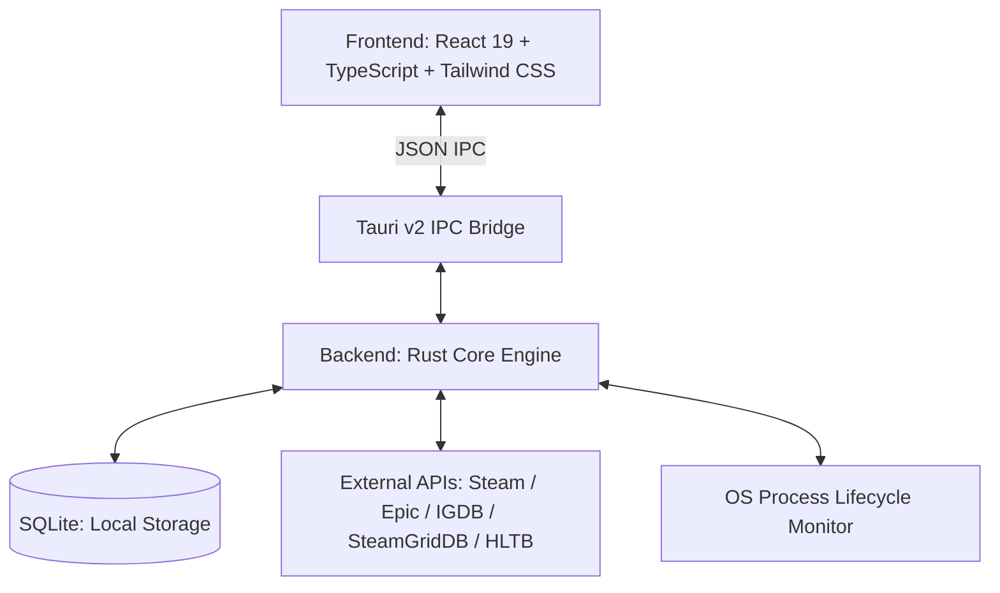

<div align="center">

# 🎮 OpenPlay

### *The next-generation open-source game launcher and library manager.*  
**Native Windows & Linux • Moving Cover Art • Built-in Superpowers • Zero Bloat**

[](https://www.gnu.org/licenses/gpl-3.0)
[](https://tauri.app)
[](https://www.rust-lang.org)
[](https://react.dev)
[](#the-cross-platform--linux-advantage)

---

</div>

<br />

## 🌟 The Vision: What Playnite Isn't

For years, PC gamers who wanted to unify their fragmented game libraries turned to **Playnite**. We honor Playnite for pioneering open-source library management on PC. 

However, gaming has evolved:
- **Playnite is locked to Windows**: Because Playnite was built on Microsoft WPF/.NET Framework, it cannot run natively on Linux, SteamOS, or the Steam Deck without cumbersome wrappers.
- **Fragmented by Extensions**: To get a basic modern experience in Playnite, users are forced to install, configure, and maintain 10+ separate plugins just for artwork, HowLongToBeat stats, video trailers, and player counts.
- **Aging Aesthetics**: Modern operating systems and displays demand high-performance glassmorphism, responsive canvas scaling, and fluid animations.

**OpenPlay is engineered from the ground up to be the game library of the next decade:**
A blazing-fast, cross-platform sanctuary for your entire game collection that does *more than enough* straight out of the box.

---

## 📸 Visual Showcase

<div align="center">

### 🖥️ Desktop Split View
*Adaptive 7-column poster grid on the left with rich live game showcase, transparent clear logos, and animated video trailers on the right.*

```
+-------------------------------------------------------------------------------------------------------------+
|  🔍 Filter & Search        [ All | Installed | Uninstalled | Filters ▼ ]     (★)  (...)  (⚙)  [  ▶ PLAY  ]  |
|-------------------------------------------------------+-----------------------------------------------------|
|  [Cover]  [Cover]  [Cover]  [Cover]  [Cover]  [Cover] |  HERO BACKDROP (Faded Glass S-Curve Mask)           |
|  [Cover]  [Cover]  [Cover]  [Cover]  [Cover]  [Cover] |  CLEAR LOGO                                         |
|  [Cover]  [Cover]  [Cover]  [Cover]  [Cover]  [Cover] |  [IN-GAME: 45k] [STEAM]         [COVER POSTER (2:3)]|
|  [Cover]  [Cover]  [Cover]  [Cover]  [Cover]  [Cover] |-----------------------------------------------------|
|  [Cover]  [Cover]  [Cover]  [Cover]  [Cover]  [Cover] |  [Video Trailer Player]   |  HLTB Widget            |
|  [Cover]  [Cover]  [Cover]  [Cover]  [Cover]  [Cover] |  Overview / Achievements  |  Metadata Details Table |
|  [Cover]  [Cover]  [Cover]  [Cover]  [Cover]  [Cover] |  Steam Community News     |  Installation Folder    |
+-------------------------------------------------------+-----------------------------------------------------+
```
*(Screenshot placeholder: `./docs/screenshots/desktop-split-view.png`)*

---

### 🎮 Fullscreen Couch Mode *(In Active Development)*
*Designed for living-room TVs, handhelds (Steam Deck, ROG Ally, Legion Go), and seamless gamepad navigation.*

*(Screenshot placeholder: `./docs/screenshots/fullscreen-couch-mode.png`)*

---

### 🎨 Live SteamGridDB Asset Explorer
*Browse, preview, and apply vertical grids, heroes, transparent clear logos, and icons in real-time without leaving the app.*

*(Screenshot placeholder: `./docs/screenshots/steamgriddb-modal.png`)*

---

### ⚙️ 7-Tab Comprehensive Game Properties
*All metadata—from custom launch arguments to playtime split and native file browsers—organized so you never get overwhelmed.*

*(Screenshot placeholder: `./docs/screenshots/game-settings-dialog.png`)*

</div>

---

## ⚡ Built-in Superpowers (Out of the Box)

No hunting through forums for third-party scripts. OpenPlay ships with essential features built directly into its core:

| Feature | OpenPlay (Native) | Traditional Launchers |
|:---|:---:|:---:|
| **Native Linux & SteamOS Support** | ✅ **Native** | ❌ Windows Only |
| **Animated & Moving Covers** (WebM, MP4, APNG, GIF) | ✅ **Built-in** | ⚠️ Complex Workarounds |
| **Steam & Epic Games Account Integration** | ✅ **Built-in** | 🔌 Requires Plugin |
| **Achievement Hub & In-Game Trophies** | ✅ **Built-in** | 🔌 Requires Plugin |
| **SteamGridDB Artwork Integration** | ✅ **Built-in** | 🔌 Requires Plugin |
| **HowLongToBeat Completion Metrics** | ✅ **Built-in** | 🔌 Requires Plugin |
| **Live Steam Player Counts & News Hub** | ✅ **Built-in** | 🔌 Requires Plugin |
| **On-Demand Video Trailers** | ✅ **Built-in** | 🔌 Requires Plugin |
| **True Window Lifetime Tracking** (Auto Revert to Play) | ✅ **Built-in** | ⚠️ Inconsistent Exit Detection |
| **Playnite Backup (.zip) Importer & Media Extractor** | ✅ **Built-in** | ❌ N/A |
| **Local Game Executable & Directory Scanner** | ✅ **Built-in** | ⚠️ Basic Manual Shortcuts |

---

## 🐧 The Cross-Platform & Linux Advantage

OpenPlay is built on top of **Tauri v2** and **Rust**, eschewing heavy Electron runtimes and Windows-only WPF frameworks:

- **Ultra-Low Memory Footprint**: Idles at a fraction of Chromium-based launchers.
- **Native Wayland & X11 Compatibility**: Runs cleanly across Arch, Ubuntu, Fedora, Nobara, and SteamOS.
- **Seamless Steam Deck Experience**: Built to look stunning on both high-DPI desktop monitors and portable handheld screens.
- **Respects User Privacy**: 100% offline-first. Your library database (`SQLite`) lives strictly on your machine. Zero telemetry, zero tracking, zero mandatory accounts.

---

## 🔄 The Playnite Migration Vision

Switching library managers shouldn't mean losing years of playtime stats, custom tags, and curated artwork. 

We are actively developing a **1-click Playnite Backup Importer**:
1. Export or point to your existing Playnite database directory.
2. OpenPlay parses your categories, completion states, playtime records, and artwork links.
3. Your entire library is instantly ready on Windows or native Linux with zero setup friction.

---

## 🏗️ Architecture & Tech Stack



- **Runtime & Desktop Shell**: [Tauri v2](https://tauri.app/)
- **Backend Systems**: [Rust](https://www.rust-lang.org/) with asynchronous process tracking and `sysinfo`
- **Database**: Embedded local SQLite via `rusqlite`
- **Frontend Framework**: [React 19](https://react.dev/) + [TypeScript](https://www.typescriptlang.org/)
- **Styling**: [Tailwind CSS v4](https://tailwindcss.com/) with custom glassmorphism design tokens
- **Media Pipeline**: Native HTML5 Video engine for looping video covers and YouTube embeds

---

## 🚀 Getting Started (Development)

### Prerequisites

Ensure you have the following installed on your machine:
- **Node.js** (v18+ recommended) & `npm`
- **Rust & Cargo** ([rustup.rs](https://rustup.rs/))
- **Windows**: [Visual Studio C++ Build Tools](https://visualstudio.microsoft.com/visual-cpp-build-tools/)
- **Linux**: Standard Tauri dependencies (`libwebkit2gtk-4.1-dev`, `build-essential`, `curl`, `wget`, `file`, `libssl-dev`, `libgtk-3-dev`, `libayatana-appindicator3-dev`, `librsvg2-dev`)

### Installation & Run

1. **Clone the repository:**
   ```bash
   git clone https://github.com/Screamycat/OpenPlay.git
   cd OpenPlay
   ```

2. **Install frontend dependencies:**
   ```bash
   npm install
   ```

3. **Launch in development mode:**
   ```bash
   npm run tauri dev
   ```

4. **Build production binaries:**
   ```bash
   npm run tauri build
   ```

---

## 🗺️ Roadmap & Community Backlog

Check out our full live tracking document in [ROADMAP.md](./ROADMAP.md) for current sprint items, feature backlogs, and bug reports.

- [x] Steam library scanning with artwork cache preservation
- [x] High-precision Windows game exit & process lifecycle detection
- [x] Glassmorphic right-click context menu at click coordinates
- [x] 7-tabbed properties dialog with native folder & executable selectors
- [x] Categorized settings system with SQLite persistent app state & session restore
- [x] 3-Tier Achievements Engine: Dedicated Achievement Hub, Steam details tab, and quick showcase widget
- [ ] **Playnite Backup Importer**
- [ ] **Native Linux packaging (.deb, .AppImage, Flatpak)**
- [ ] **Fullscreen / Couch Controller Mode**
- [ ] **Community Theme & Extension Plugin Engine**

---

## 📜 License & Open Source Philosophy

OpenPlay is proudly free and open source under the **[GNU General Public License v3.0 (GPLv3)](./LICENSE)**.

### Our Stance on Forks & Contributions:
- **Extensions & Themes**: We enthusiastically encourage community members to create custom themes, extensions, and integrations.
- **Copyleft Protection**: GPLv3 guarantees that OpenPlay and any derivative works remain **permanently open source and free**.
- **No Commercial Exploitation**: You may not take OpenPlay, close the source code, slap a new name on it, and sell or redistribute it as your own closed product.
- **Forks**: Legitimate forks created to fix critical issues, improve accessibility, or contribute upstream back to the community are warmly welcomed.

---

<div align="center">
  <sub>Built with passion for power gamers who love their collections.</sub>
</div>
