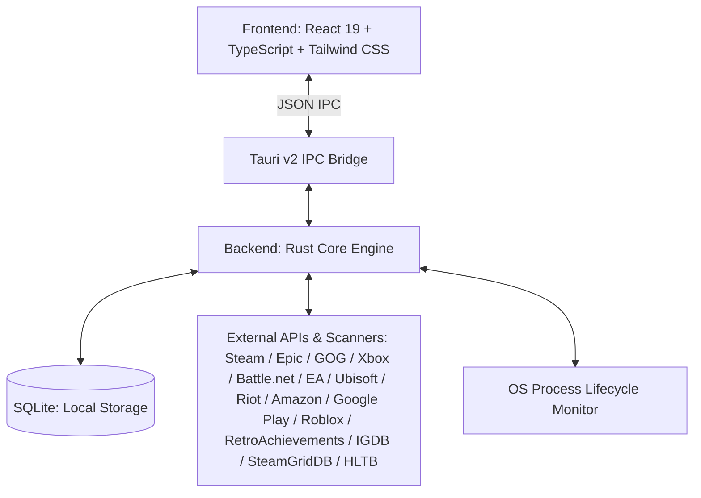

<div align="center">

# 🎮 OpenPlay

### *The next-generation open-source game launcher and library manager.*  
**Native Windows & Linux • Moving Cover Art • Built-in Superpowers • Zero Bloat**

[](https://www.gnu.org/licenses/gpl-3.0)
[](https://tauri.app)
[](https://www.rust-lang.org)
[](https://react.dev)
[](#the-cross-platform--linux-advantage)

---

</div>

<br />

## 🌟 The Landscape: Where OpenPlay Fits

PC gaming has been shaped by outstanding open-source projects, and we hold deep respect for what each has pioneered:
- **Playnite** set the benchmark on Windows for library aggregation, detailed database customization, and extensible community plugins.
- **Lutris** has long been the Linux champion for deep Wine prefix tuning, custom runner management, and community installation scripts.
- **Heroic Games Launcher** established an indispensable cross-platform client for downloading and updating Epic Games and GOG titles without official store launchers.

However, as gaming setups evolve across Windows desktops and Linux handhelds (like the Steam Deck), players often find themselves caught between trade-offs:
- **Playnite is locked to Windows**: Built on Microsoft WPF/.NET, it cannot run natively on Linux, SteamOS, or the Steam Deck without cumbersome, brittle compatibility layers. It also suffers from heavy **extension setup fatigue**—requiring users to install, configure, and maintain 10+ separate plugins just for artwork, achievements, completion stats, and trailers.
- **Lutris is Linux-centric**: While unrivaled for low-level Wine configuration, it is not available on Windows and offers a utilitarian desktop interface without modern visual polish, animated covers, or unified achievement tracking.
- **Heroic is a store client, not a unified library aggregator**: Heroic is designed primarily for downloading and playing Epic, GOG, and Amazon titles. It does not aggregate full Steam libraries, emulated retro legacy, or unified multi-store collections.

**OpenPlay is engineered to bridge these worlds:**
A blazing-fast, cross-platform sanctuary for your entire game collection built on **Tauri v2** and **Rust**. It eliminates setup fatigue by delivering the features players care about most—animated video covers, an integrated achievement hub, live Steam player counts, HowLongToBeat completion metrics, YouTube trailers, duplicate collapsing, and full retro support—**built directly into its core with zero plugins required.**

---

## 📸 Visual Showcase

<div align="center">

### 🖥️ Desktop Split View
*A sleek split layout designed for responsive library exploration. Navigate an adaptive grid of animated cover art on the left, paired with an immersive glassmorphic hero backdrop on the right featuring transparent clear logos, live Steam player counts, HowLongToBeat completion metrics, user and critic review scores, community patch notes, and instant video trailers.*


---

### 🎨 Live SteamGridDB Asset Explorer
*Search, preview, and apply community-curated vertical covers, heroes, transparent clear logos, and animated WebM posters directly inside OpenPlay. Includes style categorization, and instant 1-click downloads with zero manual asset management.*


---

### 🏆 Achievements Hub
*Track your gaming legacy across modern storefronts and retro emulators in a single unified hall of fame. View global unlock rates, trophy rarity tiers, total gamerscore, and milestone completion percentages across Steam and RetroAchievements in real time.*


---

### 🕹️ Native Emulation & Smart ROM Scanner
*Seamlessly manage your retro collection alongside modern PC titles. OpenPlay automatically detects installed standalone emulators (Dolphin, PCSX2, DuckStation, RPCS3, mGBA, PPSSPP, Cemu, Ryujinx, Eden) and RetroArch Libretro cores. Point to any ROM directory: OpenPlay strips dump release tags, deduplicates multi-track `.bin` files, matches console platforms with dedicated hardware badges, and extracts local boxart or scrapes from SteamGridDB.*

---

### 🎨 Modular Theme Engine & In-App Customization
*Personalize OpenPlay with live stylesheet hot-reloading and modular theme extensions. Tweak geometry (poster corner radius, card aspect ratios, logo scaling constraints), smoke tints, and accent colors with real-time CSS variable bindings, or drop in custom `.zip` theme packages that overhaul the interface into console-inspired layouts (like a Nintendo Switch UI).*

---

### 🎮 Fullscreen Couch Mode *(In Active Development)*
*Designed for living-room TVs, handhelds (Steam Deck, ROG Ally, Legion Go), and seamless gamepad navigation.*

*(Screenshot placeholder: `./docs/screenshots/fullscreen-couch-mode.png`)*

</div>

---

## ⚔️ Head-to-Head Comparison: OpenPlay vs. Playnite vs. Lutris vs. Heroic

Every launcher has its own design philosophy and purpose. Here is how they compare across the capabilities that matter most to players looking for a dedicated library manager:

| Capability / Feature | **OpenPlay** | **Playnite** | **Lutris** | **Heroic Games Launcher** |
| :--- | :---: | :---: | :---: | :---: |
| *Platform & Architecture* | | | | |
| **Windows Support** | ✅ **Native** | ✅ **Native** | ❌ *No* | ✅ **Native** |
| **Linux & SteamOS / Steam Deck** | ✅ **Native** | ❌ *Windows Only* | ✅ **Native** | ✅ **Native** |
| **Technology Stack** | **Tauri v2 + Rust + React 19** | C# / WPF (.NET) | Python + GTK | Electron (Chromium + Node.js) |
| **Memory Footprint (Idle)** | 🟢 **Ultra-Low (<100MB)** | 🟡 Moderate (~180–300MB) | 🟢 Low (~120–200MB) | 🔴 Higher (~350–600MB) |
| **100% Offline-First (Local SQLite)** | ✅ **Yes (Zero Telemetry)** | ✅ **Yes** | ✅ **Yes** | ✅ **Yes** |
| **Setup Experience** | ⚡ **All-in-One Out of Box** | 🔌 Requires 10+ Plugins | ⚙️ Runner / Script Setup | ⚡ Store Login Out of Box |
| *Library Unification & Management* | | | | |
| **Universal Multi-Store Aggregator** | ✅ **All Stores + Local + Retro** | 🔌 Requires Store Plugins | ⚠️ Runner / Script Scraper | ❌ Epic, GOG & Amazon only |
| **Native Emulation & ROM Scanner** | ✅ **Built-in (RetroArch & Standalones)** | 🔌 Built-in / Plugins | 👑 Runner Engine | ❌ *No* |
| **Duplicate Merger across Stores** | ✅ **Built-in (Interactive Platform Tabs)** | 🔌 Requires Plugin | ❌ Separate entries | ❌ N/A |
| **Playnite Backup Importer (.zip)** | ✅ **Built-in (1-Click Migration)** | ✅ Native Export | ❌ N/A | ❌ N/A |
| **Zero-Downtime Snapshots & Backups** | ✅ **Built-in (Auto-rotation & portable .openplaybackup)** | 🔌 Extensions / Manual | ❌ Manual file copy | ❌ N/A |
| **Cross-Device Cloud Sync (Folder Sync)** | ✅ **Built-in (Multi-Leader CRDT & PN-Counter)** | 🔌 Third-party scripts | ❌ Manual rsync | ❌ N/A |
| **Direct Store Downloading & Cloud Saves** | ⚠️ Directs to Store / Native Launch | ⚠️ Directs to Store Client | 🔌 Custom Scripts | 👑 **Built-in (Legendary/Nile)** |
| **Wine / Proton Prefix Tuning** | ⚠️ Direct Execution / Steam Proton | ❌ N/A | 👑 **Advanced Deep Runner Tuning** | ✅ Integrated Wine/Proton Tools |
| **Visuals, Media & Metadata** | | | | |
| **Animated & Moving Video Covers** | ✅ **Built-in (WebM, MP4, APNG, GIF)** | ❌ Static Only  | ❌ Static Only | ❌ Static Only |
| **In-App SteamGridDB Asset Explorer** | ✅ **Built-in (Animation support)** | 🔌 Requires Plugin  | ⚠️ Basic Scraper | ⚠️ Basic Image Selection |
| **In-App Video Trailers** | ✅ **Built-in (Store / YouTube / Video files)** | 🔌 Requires Plugin | ❌ *No* | ❌ *No* |
| **HowLongToBeat Completion Metrics** | ✅ **Built-in** | 🔌 Requires Plugin | ❌ *No* | ✅ Built-in (HLTB API) |
| **Live Concurrent Player Counts** | ✅ **Built-in (All platforms via title matching)** | 🔌 Requires Plugin | ❌ *No* | ❌ *No* |
| **Theme & Visual Customization** | ✅ **Built-in (Dedicated Themes Manager, 3+ Screenshot Gallery, .zip Import & In-App Config)** | 🔌 Requires Custom Themes | ❌ GTK Theme only | ⚠️ Fixed Palettes |
| **Plugin & Extension Architecture** | ✅ **Built-in (Dedicated Plugins Manager, .zip Import & In-App Config)** | 🔌 Extensive Plugins | ⚠️ Community Scripts | ❌ *No* |
| **Critic & User Review Scores** | ✅ **Built-in (OpenCritic & Steam)** | 🔌 Requires Plugin | ❌ *No* | ❌ *No* |
| *Trophies & Achievements* | | | | |
| **Unified Achievement Hub** | ✅ **Built-in (Global Hall of Fame)** | 🔌 Requires Plugin | ❌ *No* | ❌ *No* |
| **RetroAchievements Integration** | ✅ **Built-in (Console Trophies & Rarity)** | ❌ *No* | ❌ *No* | ❌ *No* |
| **Cross-Store Achievement Switching** | ✅ **Built-in (Per-Platform Tabs)** | ❌ *No* | ❌ *No* | ❌ *No* |
| *Power Features* | | | | |
| **Dual Launch / Multi-Action Play** | ✅ **Built-in (Action Menu)** | ✅ Built-in (Play Actions) | ✅ Runner Arguments | ⚠️ Basic Alternate Exe |
| **In-App Patch Notes & News Feed** | ✅ **Built-in** | 🔌 Requires Plugin | ❌ *No* | ❌ *No* |
| **Non-Intrusive Background Library Sync** | ✅ **Built-in (Startup & multi-device periodic sync with gameplay pause)** | 🔌 Requires Plugins / Scripts | ❌ Manual Refresh | ⚠️ Manual Store Refresh |

### 🧭 Which One Is Right For You?
- **Choose Playnite** if you game exclusively on Windows, love deep custom theme scripting (XAML), and enjoy curating a tailored library with dozens of community extensions.
- **Choose Lutris** if you game on Linux and your highest priority is low-level Wine prefix customization, manual DLL overrides, running retro installer scripts, and complex compatibility tuning.
- **Choose Heroic Games Launcher** if you specifically want a dedicated open-source client to download, update, and manage your Epic Games, GOG, and Amazon Prime libraries on Linux or macOS without the official store launchers.
- **Choose OpenPlay** if you want a **blazing-fast, unified gaming sanctuary across both Windows and Linux** that delivers a complete, visually stunning experience (animated covers, trailers, unified achievements, HowLongToBeat, and cross-platform store merging) **instantly out of the box without being bloated.**

---

## 🐧 The Cross-Platform & Linux Advantage

OpenPlay is built on top of **Tauri v2** and **Rust**, eschewing heavy Electron runtimes and Windows-only WPF frameworks:

- **Ultra-Low Memory Footprint**: Idles at a fraction of Chromium-based launchers (<100MB RAM).
- **Native Wayland & X11 Compatibility**: Runs cleanly across Arch, Ubuntu, Fedora, Nobara, and SteamOS.
- **Seamless Steam Deck Experience**: Built to look stunning on both high-DPI desktop monitors and portable handheld screens.
- **Respects User Privacy**: 100% offline-first. Your library database (`SQLite`) lives strictly on your machine. Zero telemetry, zero tracking, zero mandatory accounts.

---

## 🔄 The Playnite Migration Vision

Switching library managers shouldn't mean losing years of playtime stats, custom tags, and curated artwork. 

We have developed a **1-click Playnite Backup Importer**:
1. Import Playnite's most recent backup file.
2. OpenPlay parses your categories, completion states, playtime records, and artwork links.
3. Your entire library is instantly ready on Windows or native Linux with zero setup friction.

> With more migration to come?
---

## ☁️ Cross-Device Cloud Sync & Zero-Downtime Backups

OpenPlay is designed from the ground up to respect user sovereignty and privacy:

### 🔄 Multi-Leader Offline-First Cloud Sync
- **Zero Proprietary Cloud Lock-In**: Sync seamlessly across your desktop PC, Steam Deck, or handheld using your own cloud folder (OneDrive, Syncthing, Dropbox, Google Drive, Nextcloud, or a local network NAS).
- **No SQLite File Corruption**: Avoids raw database file syncing over cloud drives. Each device writes exclusively to its own state file (`devices/<device_id>.json`) via atomic temporary writes.
- **PN-Counter Playtime CRDT**: Tracks session playtimes as monotonic per-device maps. Offline playtime on your Steam Deck and desktop never overwrite each other; playtimes accumulate conflict-free.
- **Two-Pass Tombstones & Metadata LWW**: Deletions cleanly propagate across peer devices while user metadata edits take precedence over stale state.
- **Content-Addressed Artwork Sync**: Local custom artwork is deduplicated and hashed using SHA-256 (`custom://<sha256>.<ext>`) so every device in the cluster shares artwork with zero duplicate bandwidth.
- **Physical vs. Logical Isolation**: Syncs ratings, tags, notes, playtimes, and UI themes across devices while keeping physical install directories and executable paths strictly device-local.

### 🛡️ Live Snapshots & Portable Bundles
- **Live `VACUUM INTO` Snapshots**: Creates consistent, zero-downtime database snapshots with configurable rotation and retention limits.
- **Portable `.openplaybackup` Bundles**: Export and import your entire collection—including custom configurations and achievement histories—in a single portable zip archive.

---

## 🏗️ Architecture & Tech Stack



- **Runtime & Desktop Shell**: [Tauri v2](https://tauri.app/)
- **Backend Systems**: [Rust](https://www.rust-lang.org/) with asynchronous process tracking and `sysinfo`
- **Database**: Embedded local SQLite via `rusqlite`
- **Frontend Framework**: [React 19](https://react.dev/) + [TypeScript](https://www.typescriptlang.org/)
- **Styling**: [Tailwind CSS v4](https://tailwindcss.com/) with custom glassmorphism design tokens
- **Media Pipeline**: Native HTML5 Video engine for looping video covers and YouTube embeds

---

## 🚀 Getting Started (Development)

### Prerequisites

Ensure you have the following installed on your machine:
- **Node.js** (v18+ recommended) & `npm`
- **Rust & Cargo** ([rustup.rs](https://rustup.rs/))
- **Windows**: [Visual Studio C++ Build Tools](https://visualstudio.microsoft.com/visual-cpp-build-tools/)
- **Linux**: Standard Tauri dependencies (`libwebkit2gtk-4.1-dev`, `build-essential`, `curl`, `wget`, `file`, `libssl-dev`, `libgtk-3-dev`, `libayatana-appindicator3-dev`, `librsvg2-dev`)

### Installation & Run

1. **Clone the repository:**
   ```bash
   git clone https://github.com/Screamycat/OpenPlay.git
   cd OpenPlay
   ```

2. **Install frontend dependencies:**
   ```bash
   npm install
   ```

3. **Launch in development mode:**
   ```bash
   npm run tauri dev
   ```

4. **Build production binaries:**
   ```bash
   npm run tauri build
   ```

---

## 📜 License & Open Source Philosophy

OpenPlay is proudly free and open source under the **[GNU General Public License v3.0 (GPLv3)](./LICENSE)**.

### Our Stance on Forks & Contributions:
- **Extensions & Themes**: We enthusiastically encourage community members to create custom themes, extensions, and integrations. Check out our **[Theme Creation Guide](./docs/THEMES.md)** and **[Plugin Creation Guide](./docs/PLUGINS.md)** with starter templates!
- **Copyleft Protection**: GPLv3 guarantees that OpenPlay and any derivative works remain **permanently open source and free**.
- **No Commercial Exploitation**: You may not take OpenPlay, close the source code, slap a new name on it, and sell or redistribute it as your own closed product.
- **Forks**: Legitimate forks created to fix critical issues, improve accessibility, or contribute upstream back to the community are warmly welcomed.

---

<div align="center">
  <sub>Built with passion for power gamers who love their collections.</sub>
</div>